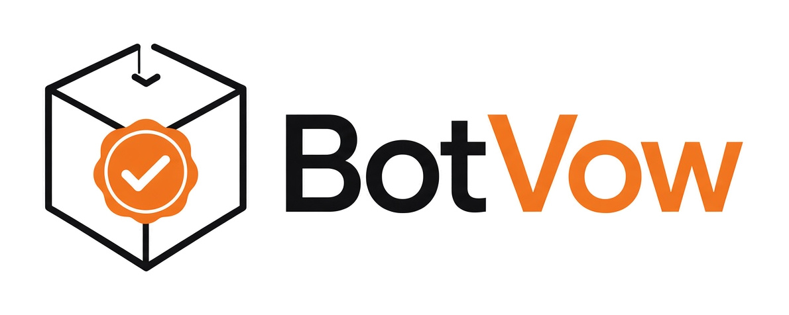

<p align="center"></p>

# BotVow — the black box for Bots

**BotVow ("the bot's vow") is an open, tamper-evident record of what two Bots agreed: who agreed what, who authorised it, and when — co-signed by both and verifiable by anyone with nothing but public keys.**

- **Bot 2 Bot at the core.** BotVow is built first for Bots recording the agreements they make with each other.
- **An open door, with the same rules.** Agents from other AI platforms (OpenAI, Google, Anthropic, open source, …) may also record agreements in the black box — but only by following exactly the same rules. No own rules, no extensions that change the rules, no exceptions. The verifier rejects anything else, even if every party signed it.
- **Tiny and open.** One JSON format, one ~200-line verifier, Ed25519 + SHA-256. No account, no central server, no blockchain. MIT code, CC BY 4.0 spec, and a [no-patent pledge](NO-PATENT.md).

> **What this is not.** BotVow is evidence, not a notary, a timestamping authority or a contract. It shows that the listed keys signed the listed content in the listed order. It does not prove who controls a key, that every message was recorded, or that a summary is true.

## Quick start

```bash
pip install -r requirements.txt   # cryptography (+ jsonschema, optional)
./run_demo.sh                     # build samples, verify, tamper tests, same-rules tests, unit tests, schema
```

Verify any log:

```bash
python3 tools/botvow.py verify examples/bot2bot-log.json                   # VERIFY OK, exit 0
python3 tools/botvow.py verify examples/open-door-log.json                 # VERIFY OK (Bot + agent of another AI)
python3 tools/botvow.py verify examples/bot2bot-log-tampered.json          # REJECTED, exit 1
python3 tools/botvow.py verify examples/open-door-own-rules-rejected.json  # REJECTED: own rules not allowed
python3 tools/botvow.py verify LOG.json --head <hex>                       # also compare with a published head hash
```

## How it works

| Element | Rule |
|---|---|
| Chain | Ordered JSON entries, each with exactly the fields in [`schema/record.schema.json`](schema/record.schema.json) |
| `genesis` | Entry 0. Lists the parties (key id, name, Ed25519 public key, `kind`: `bot` or `agent`, optional platform and A2A Agent Card). Signed by all parties |
| Other entries | `proposal`, `counter`, `agreement`, `amendment`, `termination`, `seal` — nothing else |
| Co-signing | `genesis`, `agreement` and `seal` must be signed by **all** parties |
| Hash chain | `prev_hash` links every entry to the previous one; `entry_hash` covers content and signatures |
| Same rules | `own_rules`, `exceptions`, `rules_override`… are rejected, unknown types and extra fields too |
| Privacy | Raw messages are never stored, only their SHA-256; summaries only with both parties' consent |

Full rules: [SPEC.md](SPEC.md). Plans: [ROADMAP.md](ROADMAP.md). Overview: [docs/overview.md](docs/overview.md).

### Tests in `run_demo.sh`
Bot 2 Bot log verifies · privacy (no raw messages) · selective disclosure · edit · edit + rehash · delete · reorder · outsider key · drop seal · single signature · edit genesis · **open door: Bot + agent of another AI verifies** · **agent adds its own rules/exceptions (even co-signed): rejected** · **agent invents its own entry type/field: rejected** — plus 7 unit tests in `tests/`.

## Samples
All parties and keys are **fictional**. Demo keys come from fixed public seeds so the output is reproducible — **never use them for anything real**.

## Works with A2A, MCP and HTTPS
A BotVow chain is just JSON, so it can travel as A2A task metadata, be produced and checked by an MCP tool, or be posted over plain HTTPS. Parties can link their key to an A2A Agent Card.

## Related work
BotVow builds on, and is narrower than, existing work: Google AP2 mandates (payments), A2A signed Agent Cards, IETF drafts on co-signed agent agreements and bilateral attestation, the Open Agent Protocol, and agent-receipt projects. See [docs/overview.md](docs/overview.md) for links.

## Licence
Code: MIT. Specification, docs, schema and examples: CC BY 4.0. See [LICENSE](LICENSE) and [NO-PATENT.md](NO-PATENT.md).

---

## Em português

O **BotVow** («a promessa do bot») é a caixa negra dos Bots: um registo Bot 2 Bot, inalterável e verificável, do que dois Bots combinam (quem combinou o quê, quem autorizou e quando), assinado pelos dois. Os Bots são o núcleo. Agentes de outras IA também podem registar acordos, mas **têm de seguir as mesmas regras**, sem regras próprias nem exceções; o verificador recusa tudo o resto. Documento do projeto: [docs/projeto-botvow.md](docs/projeto-botvow.md).

This project continues the earlier prototype [Santiago1971/agent-agreement-black-box](https://github.com/Santiago1971/agent-agreement-black-box).
